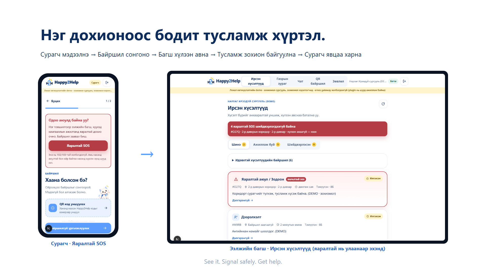

<p align="center">
  
</p>

<h3 align="center">Every student deserves to be heard. · Сурагч бүр сонсогдох эрхтэй.</h3>

<p align="center">
  Open-source school-safety plugin for <a href="https://erxes.io">erxes</a>: QR-located SOS, a real student ↔ teacher chat,
  Student Council, Student Patrol, confidential Care requests — and <b>Happy AI</b>, teacher-side incident summaries by the
  open-weight <b>Gemma 4</b> model, always reviewed by a human.
</p>

<p align="center">
  
  
  
  
  
  
</p>

<p align="center">
  
</p>

Built in one day at **Hacktoberfest Hack Day Ulaanbaatar × erxes Hub** (24 October 2026) by team **ZEVQORA**.
Everything in the demo — schools, students, staff, incidents — is **fictional**. Happy2Help is a hackathon
prototype, **not an emergency service**.

---

## Contents

1. [Why](#why) · 2. [What it does](#what-it-does) · 3. [Quick start](#quick-start-no-docker) · 4. [Architecture](#architecture)
· 5. [Happy AI · Gemma 4](#happy-ai--gemma-4) · 6. [Security model](#security-and-privacy-model) · 7. [Tests and evidence](#tests-and-evidence)
· 8. [erxes integration status](#erxes-integration--what-is-and-is-not-proven) · 9. [Films, deck, docs](#films-pitch-deck-and-documentation)
· 10. [Limitations and roadmap](#known-limitations-and-roadmap) · 11. [Contributing](#contributing) · 12. [License](#license)

## Why

A student who sees bullying, vaping or a fight brewing has to *leave* to find a teacher. By the time an adult
arrives, time has passed, the place has changed, and often nobody knows exactly what happened. The founder noticed
this gap while working with the student council and student patrol. Happy2Help closes it: **report from where you
are → the right adult responds → the student sees that someone is handling it.**

Why open source? School safety software must be **inspectable**. Schools, parents and ministries can read every
rule that decides who sees a child's report, reproduce every test, audit the AI prompt and schema, and adapt the
workflow and language to their own context. Nothing here is a black box.

## What it does

Each row below is covered by an automated end-to-end test that runs against the **real plugin process** and a
real `mongod` (see [Tests and evidence](#tests-and-evidence)).

| Module | What a user can do | Where |
|---|---|---|
| **SOS** | Pick a location on the floor map or scan a signed zone QR → category → optional text → **persisted** incident. "I am in danger now" produces a red **CRITICAL** case; ordinary reports do not. | `/student/sos`, `/student/incidents/[id]` |
| **Response workspace** | Critical-first inbox, map markers scoped to the adult's cases, acknowledge → assign responders → RESPONDING → RESOLVED, with actor/time log. | `/teacher/incidents`, `/teacher/map` |
| **Happy Connect (chat)** | Trusted-adult directory, direct rooms, per-incident follow-up thread, unread counts. | `/student/chat`, `/teacher/chat` |
| **Staff-only room** | Separate `STAFF_INTERNAL` conversation per incident; students and unassigned adults are denied even with the room id. | `/teacher/incidents/[id]` |
| **Happy Council** | Proposal → moderator approve/reject/progress (audited) → **one vote per student** (unique index). | `/student/council`, `/teacher/council` |
| **Happy Patrol** | Supervisor creates shifts → member checks in by zone QR (server-verified) or manually → observations. | `/student/patrol`, `/teacher/patrol` |
| **Happy Care** | Confidential request to the nurse / social worker / psychologist opens a CARE room with only those adults. | `/student/care`, `/teacher/care` |
| **Zone QR codes** | Printable HMAC-signed codes per zone; the code carries **no** student or school data and is **not** GPS. | `/teacher/zones`, `/student/sos?zone=…&sig=…` |
| **School floor map** | Demo SVG plan, floors 1–3 + outdoors, 24 zones; tap a room → "SOS from here". | `/student/map` |
| **Happy AI** | Teacher-only Gemma 4 summary card (PENDING / READY / FAILED / SKIPPED, retry) and a student assistant that is honest about being an AI. | `/teacher/incidents/[id]`, `/student/ai` |

### Fictional demo personas (dev sign-in page)

| Persona | Role | Shows |
|---|---|---|
| Тэмүүлэн · 8Б | student, patrol member | map → SOS, follow-up chat, Council vote, Patrol check-in |
| Уянга багш | duty teacher (sees every case of her school) | red inbox, acknowledge, assign, both chats |
| Ариунаа | social worker | assigned responder, staff room, Care |
| Мөнхзул эмч | nurse | Care; sees only cases routed to her |
| Бат багш | safeguarding lead, council moderator | oversight, approve proposals |
| Ганбаатар багш | patrol supervisor | shifts; **cannot** open SOS cases (negative demo) |
| Ихбаяр / Сараа багш | a second school | cross-school isolation |

## Quick start (no Docker)

Requirements: Node 20+, pnpm 9+. The first run downloads a MongoDB binary for `mongodb-memory-server`.

```bash
pnpm install
node tools/dev-stack.mjs
```

That starts `mongod` (persisted in `.data/`), a dev-only Redis stub, the erxes plugin on `:3399`, seeds the
fictional school, and serves the web app on **http://localhost:3100** with one-tap persona sign-in. The yellow
banner in the app states that this is **dev-direct** mode (the BFF talks to the plugin's own subgraph and sets the
identity headers an erxes gateway would set). Dev-direct must never be exposed publicly.

Optional Happy AI: `cp .env.example .env` and set `OPENROUTER_API_KEY` (server-side only; never committed).
Without a key the SOS flow is unchanged and analyses are stored as `SKIPPED`.

## Architecture

```
Student / teacher browser  (Next.js 15 app · Mongolian, mobile-first)
        │  HTTPS · HttpOnly HMAC session cookie
        ▼
web/  BFF  /api/graphql  — allow-listed operations only (lib/server/operations.ts)
        │  gateway identity headers (user / cpuser / clientportal)
        ▼
api/  Happy2Help erxes API plugin  — @erxes/api-shared startPlugin · GraphQL Federation 2 subgraph
        │  own ACL: tenant → school → role → case scope · idempotent mutations
        ├──► MongoDB  happy2help_* collections (incidents, conversations, proposals, shifts, zones, aiAnalyses)
        ├──► Redis service discovery (official erxes plugin registration; dev stub locally)
        └──► after the SOS is committed: async AI job → Gemma 4 (hosted inference) → Zod validation → teacher-only card
```

Details: [`docs/ARCHITECTURE.md`](docs/ARCHITECTURE.md) · erxes specifics: [`docs/erxes-plugin-scaffold-notes.md`](docs/erxes-plugin-scaffold-notes.md).

## Happy AI · Gemma 4

Happy AI is deliberately small and humble. It **never** acknowledges, assigns, closes, blames or dispatches.

| | |
|---|---|
| Model | **Gemma 4** (open weights, Google DeepMind) — default `google/gemma-4-26b-a4b-it`; Gemma-4-only fallback chain (`:free` variants, `gemma-4-31b-it`) |
| Provider | OpenRouter (OpenAI-compatible endpoint), key server-side only. Optional alternatives in code: Gemini API and Anthropic Claude (`HAPPY_AI_PROVIDER`); **Gemma 4 via OpenRouter is the default and the path we verified**. |
| Order of operations | SOS saved **first** → async job with a 25 s timeout and per-process call cap → bounded retries on 429 / 503 / network |
| Prompt | `api/src/modules/ai/prompt.ts`, versioned `happy-ai-gemma4-v1`; the student's text is wrapped in delimiters and declared *data, not instructions* |
| Output contract | strict Zod schema — `categorySuggestion`, `urgency`, `confidence`, `summaryMn`, `riskIndicatorsMn`, `teacherActionsMn`, `uncertaintyNoteMn`; anything else → `FAILED`, never shown as AI |
| Who sees it | teachers in case scope, labelled «AI-ийн санал · Эцсийн шийдвэрийг багш гаргана»; students never see teacher analyses |
| Evaluation | `api/eval/incidents.mn.json` — 10 fictional Mongolian cases incl. a prompt-injection case → `pnpm ai:eval` |

**Live proof (2026-10-24, 15:42 Ulaanbaatar):** `pnpm ai:verify` → `google/gemma-4-26b-a4b-it:free`, **8.9 s**, schema-valid
Mongolian summary of a fictional bullying case → [`docs/ai-proof/latest.json`](docs/ai-proof/latest.json) (no secrets).
An earlier 15:01 run (`gemma-4-31b-it:free`, 12.2 s) contained a mixed-script artefact in one action item — a reminder
that *schema-valid ≠ reliable*; a human decides. Free-tier capacity fluctuates (429) and paid slugs need credits (402);
the UI shows `FAILED · QUOTA` honestly and the SOS flow keeps working without AI. Model card: [`docs/AI_MODEL.md`](docs/AI_MODEL.md).

**License clarity:** the Happy2Help code is **AGPL-3.0-only**. Gemma 4 is an **open-weight model under Google's
Gemma Terms of Use**, accessed through hosted inference — a different licence, not AGPL. We did not train or fine-tune
any model.

## Security and privacy model

- **Authorization in every resolver**, derived from the identity the erxes gateway forwards: tenant (subdomain) →
  school membership → role (`STUDENT` / `TEACHER`) → extra roles (`COUNCIL_MODERATOR`, `PATROL_SUPERVISOR`, `NURSE`,
  `SOCIAL_WORKER`, `SAFEGUARDING_LEAD`, …) → **case scope**. Out-of-scope ids return the same `INCIDENT_NOT_FOUND`
  as missing ones.
- **Two rooms, one lock:** the student's `INCIDENT` chat and the staff `STAFF_INTERNAL` room are separate
  conversations; tests prove students, patrol, council and unassigned adults are denied by id.
- **Idempotency:** `clientRequestId` on SOS, `clientMessageId` on messages, a unique index on Council votes.
- **Signed QR:** the code carries `zone` + `sig` (HMAC-SHA256, server secret). The server derives the school from the
  authenticated student and rejects foreign or forged codes. A QR proves *which checkpoint was scanned*, not where a
  person stands.
- **Secrets:** server-side only; `.env` is git-ignored; CI-style push protection is honoured (a pasted key was caught
  and removed before it ever reached GitHub — see `git log`).
- **Data:** fictional only in this repository. A real deployment needs school consent, a data-processing agreement with
  the inference provider and a review of the Gemma Terms. Report issues via [`SECURITY.md`](SECURITY.md).

## Tests and evidence

| Suite | Command | Result (2026-10-24) |
|---|---|---|
| Typecheck plugin + web | `pnpm --filter happy2help_api check` · `pnpm --filter happy2help_web exec tsc --noEmit` | PASS |
| Unit (AI contract, prompt sanitisation, QR signatures) | `pnpm --filter happy2help_api test` | **12/12** |
| End-to-end through the real `startPlugin` process + real `mongod` | `pnpm --filter happy2help_api test:e2e` | **48/48** |
| Live judge journey through the running BFF → plugin → Mongo | `node tools/smoke-bff.mjs` | **15/15** |
| Production build of the web app | `NODE_ENV=production NEXT_DIST_DIR=.next-build pnpm --filter happy2help_web build` | PASS, 25 routes |
| Live Gemma 4 inference | `pnpm ai:verify` | PASS, proof in `docs/ai-proof/latest.json` |
| Federation composition of the live subgraph SDL | `node tools/federation-check.mjs` | 40/40 root fields |

All results are **local**: they are not a production SLA and say nothing about real-world outcomes.
Full log: [`docs/TEST_RESULTS.md`](docs/TEST_RESULTS.md) · release status: [`docs/FINAL_RELEASE_CHECKLIST.md`](docs/FINAL_RELEASE_CHECKLIST.md).

## erxes integration — what is and is not proven

- **Proven locally:** a standalone erxes API plugin generated with `npx @erxes/create-plugin`, started with
  `startPlugin` from `@erxes/api-shared@3.3.4`; Federation 2 subgraph on `/graphql`, `/health`, gateway identity
  headers decoded into the resolver context, Redis service-discovery keys written by the running plugin
  (`node tools/redis-keys.mjs`), supergraph composition of all 40 root fields.
- **Not implemented:** an erxes Core UI remote (Module Federation). `erxes.json` declares the `ui` slot; the student
  and staff UI ship as the separate Next.js app in `web/`.
- **Not verified:** a real erxes gateway serving these operations (no Docker on the build machine), and the hosted
  tenant `zevqora.next.erxes.io`, where third-party plugins need operator provisioning. Gateway-mode login is implemented
  in `web/lib/server/` but untested without a host. Enablement notes for an erxes operator:
  [`docs/erxes-plugin-scaffold-notes.md`](docs/erxes-plugin-scaffold-notes.md).

## Films, pitch deck and documentation

| Asset | Path |
|---|---|
| Technical keynote, 5:04, 11 chapters, real footage, Mongolian subtitles | `artifacts/film/Happy2Help-Technical-Keynote.mp4` · script `docs/KEYNOTE_SCRIPT.md` |
| Launch teaser, 1:46 | `artifacts/film/Happy2Help-Launch-Demo.mp4` |
| Judges pitch deck, 8 slides + live-demo cue | `presentation/Happy2Help-Final-Judges-Pitch.pptx` (+ PDF, previews) · `presentation/PITCH_SCRIPT.md` |
| Screenshots at 390 / 768 / 1440 | `artifacts/screenshots/`, `artifacts/screenshots/review-after/` |
| Film tooling (Remotion 4, recordings, procedural soundtrack) | `video/`, `tools/film/` |
| Judges' Q&A, demo guide, provenance | `docs/JUDGES_QA.md`, `docs/DEMO.md`, `docs/HACKDAY_CHANGES.md` |

Everything on screen in the films and the deck is a real recording or screenshot of this code with fictional data;
the Happy AI card in the deck shows the real verified output and is labelled as such.

## Known limitations and roadmap

**Limitations today:** no public deployment (dev-direct is local-only by design); erxes gateway / Core UI integration
pending operator access; Happy AI depends on upstream capacity; QR scanning with a physical phone camera has not been
tested (server-side verification has).

**Next:** a secure pilot with school approval and privacy controls → real erxes gateway + Core UI remote → stable
hosting with gateway-mode auth → physical QR test → broader evaluation set for Happy AI and a reviewer workflow for its
suggestions.

## Repository layout

```
api/            erxes plugin: startPlugin, Mongoose models, GraphQL schema/resolvers, ACL, Happy AI, seed, tests (unit + e2e)
web/            Next.js 15 app (student + staff), BFF, allow-listed GraphQL proxy, session
tools/          dev-stack.mjs (no-Docker stack), dev-redis.mjs, smoke-bff.mjs, federation-check.mjs, film/ recorders
presentation/   judges deck builder (python-pptx) + outputs
video/          Remotion project: teaser + technical keynote
docs/           architecture, AI model card, erxes integration, tests, scripts, ai-proof/
artifacts/      screenshots and rendered films
```

## Contributing

Issues and pull requests are welcome — see [`CONTRIBUTING.md`](CONTRIBUTING.md) (dev loop, test commands, style),
[`CODE_OF_CONDUCT.md`](CODE_OF_CONDUCT.md) and [`SECURITY.md`](SECURITY.md). Good first contributions: more Mongolian
eval cases for Happy AI, additional negative authorization tests, translations of the UI strings, and an erxes Core UI remote.

## License

**AGPL-3.0-only** — see [`LICENSE`](LICENSE). The erxes SDK is AGPL-3.0; Next.js, Mongoose, Zod and the other
dependencies keep their own licences. Gemma 4 weights are Google DeepMind's under the Gemma Terms of Use and are not
redistributed here. Brand assets (the white kitten with the blue scarf, wordmark) belong to team ZEVQORA.

<p align="center"><br><sub>Built with care by ZEVQORA · Ulaanbaatar · 2026</sub></p>
